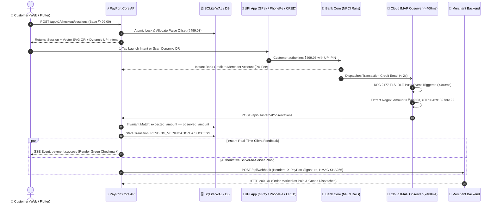
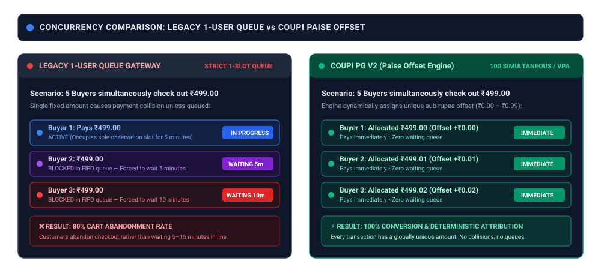

<div align="center">

```
██████╗  █████╗ ██╗   ██╗██████╗  ██████╗ ██████╗ ████████╗
██╔══██╗██╔══██╗╚██╗ ██╔╝██╔══██╗██╔═══██╗██╔══██╗╚══██╔══╝
██████╔╝███████║ ╚████╔╝ ██████╔╝██║   ██║██████╔╝   ██║   
██╔═══╝ ██╔══██║  ╚██╔╝  ██╔═══╝ ██║   ██║██╔══██╗   ██║   
██║     ██║  ██║   ██║   ██║     ╚██████╔╝██║  ██║   ██║   
╚═╝     ╚═╝  ╚═╝   ╚═╝   ╚═╝      ╚═════╝ ╚═╝  ╚═╝   ╚═╝   
```

# ⚡ PayPort PG V2

### Enterprise Sovereign, 100% Cloud-Native 0%-Fee UPI Payment Engine
**Bypass 2% + 18% GST Gateway Fees • Zero Hardware (No Physical Phones/SIMs) • High-Concurrency Paise Offset Engine • Instant IMAP IDLE Push (<400ms) • Sub-Second Direct Bank Settlement**

<br/>

[](https://nodejs.org)
[](#-stop-paying-2--18-gst-to-payment-aggregators)
[](#-bank-email-push-setup-zero-hardware)
[-0284c7?style=for-the-badge)](#-high-concurrency-paise-offset-engine)
[](#-multi-vpa-auto-rotation--daily-limit-guard)
[](#-phase-2-enterprise-hybrid-routing-bank-smart-collect)
[](#option-c-official-zero-boilerplate-flutter-package-payport_flutter)
[-success?style=for-the-badge&logo=vitest&logoColor=white)](#-testing--chaos-verification-suite)

<br/>

<p align="center">
  <a href="#-executive-summary--business-impact">Business Impact</a> •
  <a href="#-architectural-highlights-system-design-deep-dive">System Design</a> •
  <a href="#-interactive-architecture--sequence-diagrams">Architecture Flow</a> •
  <a href="#-high-concurrency-paise-offset-engine">Paise Offset</a> •
  <a href="#-bank-email-push-setup-zero-hardware">Bank Observer</a> •
  <a href="#-multi-vpa-auto-rotation--daily-limit-guard">Multi-VPA Guard</a> •
  <a href="#-developer-integration-web-node--flutter">Developer Integration</a> •
  <a href="#-authoritative-server-to-server-webhooks">Webhooks</a> •
  <a href="#-quickstart-in-60-seconds">Quickstart</a>
</p>

---

</div>

<br/>

## 💼 Executive Summary & Business Impact

### The Billion-Dollar Problem with Traditional Indian Payment Gateways
Digital merchants and platforms in India processed over **131 Billion UPI transactions in 2023–2024**. Yet, traditional payment aggregators (Razorpay, Cashfree, PayU, Paytm, Stripe India) impose severe structural penalties on businesses:

| Problem Dimension | Traditional Aggregator Tax | ⚡ PayPort PG Sovereign Solution |
| :--- | :--- | :--- |
| **Aggregator Fee Drain** | **2.0% + 18% GST** on every transaction (₹23.60 per ₹1,000 GMV). | **0.0% Gateway Fees Forever.** 100% of customer funds reach your bank account. |
| **Settlement Cycles** | **T+2 to T+3 business days** lockup. Weekend & holiday cash freezes. | **Instant Real-Time Settlement.** Funds credit directly into your liquid bank balance via NPCI rails. |
| **Merchant Account Risk** | Arbitrary KYC holds, risk department reserve freezes, and unilateral merchant bans. | **Sovereign Infrastructure.** You control the cloud servers, receiving VPAs, database, and encryption keys. |
| **Prior P2P Hack Fragility** | Required dedicated physical Android smartphones plugged into chargers 24/7 running battery-bloating SMS forwarding APKs, or 1GB+ Puppeteer Chrome scrapers crashing cloud containers. | **100% Cloud-Native TLS Sockets.** Direct RFC 2177 IMAP IDLE push listeners (~25MB RAM). Zero phones, zero SIM cards, zero headless browsers. |
| **Concurrency Collisions** | Single-user 5-minute queue locks to prevent simultaneous duplicate-amount collisions. | **Algorithmic Paise Offset Engine.** Supports 100 simultaneous checkouts per base price point with deterministic mathematical attribution. |

### The Unit Economics: What You Actually Save

```
Monthly GMV:          ₹10,00,000 (10 Lakhs)
Aggregator Fee (2%):  - ₹20,000.00
GST on Fee (18%):     -  ₹3,600.00
Annual Revenue Loss:  - ₹2,83,200.00 / year
----------------------------------------------------------------------
With PayPort PG:      ₹0.00 Fees • Save ₹2,83,200+ directly to EBITDA
```

---

<br/>

## 🏗️ Architectural Highlights: System Design Deep Dive

PayPort PG V2 is engineered as a high-throughput, fault-tolerant distributed system designed to deliver sub-second payment confirmation without intermediaries.

```
┌──────────────────────────────────────────────────────────────────────────────────────────────────┐
│                                   PAYPORT PG SYSTEM TOPOLOGY                                     │
└──────────────────────────────────────────────────────────────────────────────────────────────────┘

   [ Buyer (Browser / iOS / Android) ]
                    │
                    ▼  (1) Launch Checkout
   ┌──────────────────────────────────┐
   │ Checkout Portal (Port 7000)      │ ──[ Serves Apple HIG Checkout UI & payport.js ]
   └─────────────────┬────────────────┘
                     │ (Internal JSON Proxy)
                     ▼
   ┌──────────────────────────────────┐
   │ Payment Core REST API (Port 6100)│
   ├──────────────────────────────────┤
   │ • Paise Offset Engine (₹0-₹0.99) │ ──► [ SQLite WAL / PostgreSQL ACID Engine ]
   │ • Multi-VPA Rotator Guard        │ ──► [ AES-256-GCM Vault & Identity Store ]
   │ • Decoupled Dual-Timer Machine   │ ──► [ Idempotency SHA-256 Memory Table ]
   │ • Real-time SSE Push Stream      │
   └─────────────────┬────────────────┘
                     │
         ┌───────────┴─────────────────────────────┐
         ▼                                         ▼
   [ Vector Dynamic QR ]                 [ Direct Bank Credit ]
   upi://pay?pa=...&am=499.03            Customer pays via GPay / PhonePe / Paytm / CRED
         │                                         │
         │                                         ▼
         │                               [ NPCI / Bank Core Switch ]
         │                                         │  (Dispatches instant credit email alert)
         │                                         ▼
         │                         ┌──────────────────────────────────┐
         │                         │ IMAP Observer Daemon (Port 6003) │
         │                         ├──────────────────────────────────┤
         │                         │ • Persistent RFC 2177 TLS Socket │
         │                         │ • Multi-Bank Regex Parser Engine │
         │                         │ • < 400ms Sub-Second Push Catch  │
         │                         └───────────────┬──────────────────┘
         │                                         │
         ▼                                         ▼
   [ Customer UI: Instant SSE Green Tick ] ◄── [ Verification Pipeline Invariant Match ]
                                                   │
                                                   ▼
                                       ┌──────────────────────────────────┐
                                       │ Webhook Engine (HMAC-SHA256)     │
                                       │ • Exponential Backoff + Jitter   │
                                       │ • Authoritative Proof of Payment │
                                       └───────────────┬──────────────────┘
                                                       │
                                                       ▼
                                         [ Merchant Production Backend ]
```

---

<br/>

## ⏱️ Interactive Architecture & Sequence Diagrams

### Sub-Second End-to-End Verification Sequence



---

<br/>

## 🎯 High-Concurrency Paise Offset Engine

<p align="center">
  
</p>

### The Fundamental Attribution Challenge in P2P UPI
When an end-user sends money via P2P UPI, bank notifications omit internal merchant Order IDs. The incoming notification contains strictly:
```
"Your A/c XXX123 is credited with INR 500.00 on 15-Nov-26 by UPI/429182736192/Mohit..."
```
If **5 different buyers** simultaneously purchase a ₹500 item, how does the system know which buyer paid? Legacy tools forced all buyers into a **5-minute sequential FIFO queue**, destroying checkout conversion.

### The PayPort Solution: Deterministic Micro-Offsets
PayPort assigns an ephemeral sub-rupee paise offset (`₹0.00` to `₹0.99`) to each simultaneous checkout for identical base amounts:
- **Buyer 1**: Pays **₹500.00**
- **Buyer 2**: Pays **₹500.01**
- **Buyer 3**: Pays **₹500.02**
- ... up to **Buyer 100**: Pays **₹500.99**

```
Base Price: ₹499.00
Available Offsets: [00, 01, 02, 03, ... 99]
                    │
  ┌─────────────────┼─────────────────┐
  ▼                 ▼                 ▼
Slot 00           Slot 01           Slot 02
Session: ORD-1    Session: ORD-2    Session: ORD-3
Amt: ₹499.00      Amt: ₹499.01      Amt: ₹499.02
Status: ACTIVE    Status: ACTIVE    Status: ACTIVE
```

#### Why This Works in Production:
1. **Zero Customer Friction**: An offset of 1 paise to 99 paise (₹0.01 – ₹0.99) is universally accepted and completely imperceptible to online shoppers.
2. **100% Deterministic Attribution**: When bank notification triggers for `INR 499.02`, Buyer 3 is attributed with **zero ambiguity** and transitioned to `SUCCESS`.
3. **Instant Slot Recycling**: As soon as a transaction succeeds or expires, its offset is immediately returned to the pool for the next buyer.
4. **Multi-VPA Multiplier**: With 5 pooled merchant VPAs, capacity scales to `5 × 100 = 500` simultaneous checkouts on the exact same price point!

---

<br/>

## 📡 Bank Email Push Setup (Zero Hardware)

Indian commercial banks (HDFC, ICICI, SBI, Axis, Kotak, IDFC, PNB, Canara) dispatch transaction credit alert emails **within 1–2 seconds** of funds clearing NPCI switches.

### Zero Hardware vs. Legacy SIM-Box Fragility
```
Legacy Architecture (Fragile):
[Bank SMS] ──► [Physical Android Phone on Charger] ──► [Battery Swelling] ──► [Process Killed] ──► Downtime

PayPort Architecture (Resilient):
[Bank Alert] ──► [Gmail / Corporate Email] ──► [RFC 2177 IMAP IDLE Push] ──► [<400ms Ingestion] ──► 99.99% Uptime
```

### 3-Step Setup Guide:
1. **Set Up Alert Destination**: In your net banking portal, add your dedicated email (e.g. `alerts@yourdomain.com` or a dedicated Gmail) for transaction alerts.
2. **Generate Google App Password**:
   - Go to [Google Security Settings](https://myaccount.google.com/security) ➔ Enable 2-Step Verification.
   - Under **App Passwords**, generate a 16-character key named `PayPort Engine`.
3. **Configure `.env`**:
   ```env
   IMAP_HOST=imap.gmail.com
   IMAP_PORT=993
   IMAP_USER=alerts@yourdomain.com
   IMAP_PASSWORD=abcdefghijklmnop
   ```

PayPort maintains a persistent TLS socket. When a bank email arrives, the IMAP server emits an immediate `exists` push event, parsed by PayPort's regex engine in **< 400ms**.

---

<br/>

## 🛡️ Multi-VPA Auto-Rotation & Daily Limit Guard

NPCI imposes strict daily ceilings on standard consumer/merchant VPAs: **₹1,00,000 / day** or **20 daily transactions**.

```
  ┌─────────────────────────────────────────────────────────────────────────────┐
  │                   MULTI-VPA AUTO-ROTATION & CAPACITY GUARD                  │
  └─────────────────────────────────────────────────────────────────────────────┘

    Incoming Checkout (₹499.00)
                │
                ▼
  ┌───────────────────────────┐
  │  VpaRotatorEngine Check   │
  └─────────────┬─────────────┘
                │
    ┌───────────┴──────────────────────────────┐
    ▼                                          ▼
[ VPA #1: merchant@hdfc ]               [ VPA #2: merchant@icici ]
Today's Volume: ₹89,800                 Today's Volume: ₹12,000
Safety Ceiling: ₹90,000                 Safety Ceiling: ₹90,000
Daily Tx Count: 19 / 20                 Daily Tx Count: 3 / 20
    │                                          ▲
    │ (Headroom Full / > ₹90k)                 │ (Promoted Instantly!)
    └───────────────── AUTO-ROTATE ────────────┘
```

- **Proactive Headroom Buffer**: Rotates accounts at **₹90,000** (10% buffer below the ₹1L limit) to prevent payment failures.
- **Transaction Frequency Guard**: Rotates when transaction count reaches 19 / 20.
- **Round-Robin Load Balancing**: Evenly distributes throughput across healthy receiving accounts.

---

<br/>

## ⚡ Phase 2 Enterprise Hybrid Routing (Bank Smart Collect)

For enterprise merchants with high transaction values or volumes exceeding **1,000 orders/day**, PayPort provides a hybrid router (`HybridPaymentRouter`):

```
                        HYBRID PAYMENT ROUTER
                          Order Amount (₹)
                                  │
                  ┌───────────────┴───────────────┐
                  ▼                               ▼
        Amount < ₹2,000 (Retail)         Amount >= ₹2,000 (High-Ticket)
                  │                               │
                  ▼                               ▼
       ┌─────────────────────┐         ┌─────────────────────┐
       │  PayPort Sovereign  │         │  Bank Smart Collect │
       │  P2P UPI (0% Fee)   │         │  Dynamic Virtual A/c│
       └──────────┬──────────┘         └──────────┬──────────┘
                  │                               │
            0% Gateway Cut                  Flat ₹1.00 / txn
            0 Hardware                      (ICICI / Yes Bank)
            Instant IMAP Push               Direct Bank Webhook
```

### The Fee Comparison: Aggregator vs. Bank Smart Collect
| Order Value | Aggregator Fee (2% + 18% GST) | PayPort Hybrid (Bank Smart Collect) | Your Net Savings |
| :--- | :--- | :--- | :--- |
| **₹500.00** | ₹11.80 | **₹0.00** *(0% PayPort P2P)* | **+ ₹11.80 (100%)** |
| **₹2,000.00** | ₹47.20 | **₹1.00** *(Flat Bank Fee)* | **+ ₹46.20 (97.8%)** |
| **₹10,000.00** | ₹236.00 | **₹1.00** *(Flat Bank Fee)* | **+ ₹235.00 (99.5%)** |
| **₹50,000.00** | ₹1,180.00 | **₹1.00** *(Flat Bank Fee)* | **+ ₹1,179.00 (99.9%)** |

---

<br/>

## 💻 Developer Integration: Web, Node & Flutter

### Option A: Universal 1-Script Integration (HTML / React / Next.js / Vue)

Embed the lightweight SDK in your website:
```html
<script src="http://localhost:7000/payport.js" data-payport-key="YOUR_MERCHANT_KEY"></script>
```

Add `data-payport-pay` to any button:
```html
<button 
  data-payport-pay 
  data-order-id="ORDER-1001" 
  data-amount="499"
  data-customer-name="Mohit Sharma"
  data-customer-email="mohit@example.com"
  data-customer-phone="9876543210">
  Pay ₹499 via UPI (0% Fees)
</button>
```

### Option B: Programmatic JavaScript / TypeScript API

```javascript
import { PayPort } from '@payport/merchant-sdk';

PayPort.pay({
  order_id: "ORDER-1001",
  amount: 499.00,
  customer: {
    name: "Mohit Sharma",
    email: "mohit@example.com",
    phone: "9876543210"
  },
  handler: function(response) {
    console.log("Payment Confirmed!", response);
    // response: { status: "SUCCESS", order_id: "ORDER-1001", amount: "499.03", utr: "429182736192" }
  },
  onClose: function() {
    console.log("Modal closed by user");
  }
});
```

### Option C: Official Zero-Boilerplate Flutter Package (`payport_flutter`)

For native Android & iOS Flutter apps:

```yaml
# pubspec.yaml
dependencies:
  payport_flutter:
    path: ./packages/coupi-flutter # or pub.dev
```

```dart
import 'package:coupi_flutter/coupi_flutter.dart';

// In your Flutter Widget tree:
CoupiPayButton(
  amount: 499.00,
  orderId: 'ORDER-1001',
  customerName: 'Aarav Sharma',
  customerPhone: '9876543210',
  onPaymentSuccess: (res) {
    print('Verified! UTR: ${res.utr}, Amount: ₹${res.amountRupees}');
  },
  onPaymentFailed: (error) => print('Payment failed: $error'),
)
```

#### What the Flutter SDK Automates:
1. **Dynamic Session Creation**: Invokes `POST /api/v1/checkout/sessions` with paise offset allocation.
2. **Native UPI Intent Invocation**: 1-Tap opens installed apps (GPay, PhonePe, Paytm, CRED, BHIM).
3. **Intent Return Parsing**: Captures `ApprovalRefNo` directly from Android intent return parameters.
4. **Clipboard UTR Auto-Detection (`WidgetsBindingObserver`)**: Automatically inspects clipboard for 12-digit UTR upon returning to app.
5. **Real-time SSE Stream**: Streams `/api/v1/sessions/:id/stream` for instant confirmation.

---

<br/>

## 🔒 Authoritative Server-to-Server Webhooks

> [!IMPORTANT]
> **Authoritative Order Fulfillment Guarantee:**  
> Frontend browser events are purely for client feedback. Never fulfill digital goods or ship orders until your backend receives the cryptographically verified HMAC-SHA256 server-to-server webhook.

### Webhook HTTP Specification:
- **HTTP Method**: `POST`
- **Headers**:
  - `Content-Type: application/json`
  - `X-Gateway-Event: SUCCESS`
  - `X-Gateway-Signature: sha256=<64_hex_hash>`
  - `X-Gateway-Delivery-Id: <uuid>`

### Production Webhook Verification in Node.js (Express):
```javascript
import express from 'express';
import crypto from 'node:crypto';

const app = express();

// CRITICAL: Webhook verification MUST run on RAW unparsed bytes
app.post('/api/webhook', express.raw({ type: 'application/json' }), (req, res) => {
  const signature = req.headers['x-gateway-signature'] || '';
  const secret = process.env.PAYPORT_WEBHOOK_SECRET;

  const expected = 'sha256=' + crypto
    .createHmac('sha256', secret)
    .update(req.body)
    .digest('hex');

  // Prevent timing attacks via constant-time comparison
  if (!crypto.timingSafeEqual(Buffer.from(signature), Buffer.from(expected))) {
    return res.status(401).json({ error: 'Signature mismatch' });
  }

  const event = JSON.parse(req.body.toString('utf8'));
  if (event.event === 'SUCCESS') {
    console.log(`Order ${event.orderId} verified with Bank UTR: ${event.utr}`);
    // Mark order as PAID in your primary database
  }

  res.status(200).json({ received: true });
});
```

### Python (FastAPI / Flask) Verification:
```python
import hmac, hashlib

def verify_webhook(raw_body: bytes, signature_header: str, secret: str) -> bool:
    expected = "sha256=" + hmac.new(secret.encode(), raw_body, hashlib.sha256).hexdigest()
    return hmac.compare_digest(signature_header, expected)
```

---

<br/>

## 📁 Repository Structure & Microservices

```text
payport/
├── apps/
│   ├── payment-api/          # Core payment REST API, state machine, SSE engine, auth
│   ├── checkout-portal/       # Apple HIG customer checkout page, dynamic QR, payport.js SDK
│   ├── merchant-admin/        # Merchant console, VPA manager, transaction ledger, audit logs
│   ├── control-center/        # Local process supervisor & multi-service cluster monitor
│   ├── gmail-observer/        # Cloud-native RFC 2177 IMAP IDLE push observer daemon
│   ├── payment-help/          # Customer dispute center & UTR resolution workflow
│   └── coin-wallet-store/     # Reference e-commerce storefront showcasing universal SDK
├── packages/
│   ├── core/                  # Algorithmic engine: Paise Offset, VPA Rotator, Webhooks
│   ├── db/                    # Universal database layer: SQLite WAL & PostgreSQL schemas
│   ├── common/                # Shared utilities, crypto helpers, validation schemas
│   ├── merchant-sdk/          # Official Node.js / Browser PayPort SDK
│   ├── observer-sdk/          # Client SDK for bank observation ingestion
│   └── coupi-flutter/         # Official zero-boilerplate Flutter widget package
├── scripts/
│   ├── test-all.js            # Curated 33-suite regression test runner
│   ├── chaos-concurrency.test # 100-worker simultaneous payment collision stress test
│   ├── dev.js                 # Multi-process development supervisor
│   └── start.js               # Production supervisor
├── openapi.yaml               # OpenAPI 3.0.3 specification for all REST endpoints
├── ARCHITECTURE.md            # Canonical system architecture & engineering specification
└── AGENTS.md                  # Integration guide for AI coding agents & LLM architects
```

---

<br/>

## ⚡ Quickstart in 60 Seconds

### Prerequisites:
- Node.js 20+ LTS or Node.js 22 (`node -v`)
- npm 10+ (`npm -v`)

### 1. Clone & Install:
```bash
git clone https://github.com/nipun68/PayPort.git
cd PayPort
npm install
```

### 2. Configure Environment:
```bash
cp .env.example .env
```

Edit `.env` to configure your receiving VPA and email observer:
```env
# Server Ports
PAYMENT_API_PORT=6100
CHECKOUT_PORTAL_PORT=7000
MERCHANT_ADMIN_PORT=6001
GMAIL_OBSERVER_PORT=6003

# IMAP Bank Alert Credentials
IMAP_HOST=imap.gmail.com
IMAP_PORT=993
IMAP_USER=your-bank-alerts@gmail.com
IMAP_PASSWORD=your-google-app-password
```

### 3. Launch Development Cluster:
```bash
npm run dev
```

All 5 core microservices spin up with live hot-reloading:
```
🟢 ALL PAYPORT SERVICES OPERATIONAL
====================================================
• Merchant Admin Console:    http://localhost:6001
• Payment Core REST API:     http://localhost:6100
• Customer Checkout Portal:  http://localhost:7000/checkout/:id
• Bank Email Observer:       http://localhost:6003
• Showcase Demo Store:       http://localhost:5000
• Cluster Control Center:    http://localhost:8090
====================================================
```

---

<br/>

## 🌐 Port Bindings & Network Topology

| Port | Service | Entrypoint | Health Check | Role |
| :---: | :--- | :--- | :---: | :--- |
| **`6100`** | **Payment Core REST API** | `apps/payment-api/src/index.js` | `GET /health` | State machine, atomic DB transactions, SSE streams, paise offset allocator |
| **`7000`** | **Checkout Portal** | `apps/checkout-portal/src/index.js` | `GET /health` | Serves `payport.js`, customer iframe `/checkout/:id`, vector SVG QR |
| **`6001`** | **Merchant Admin Console**| `apps/merchant-admin/src/index.js` | `GET /health` | Receiving VPA management, live transaction monitor, webhook testing |
| **`6003`** | **Bank Email Observer** | `apps/gmail-observer/src/index.js` | `GET /health` | Persistent RFC 2177 IMAP IDLE listener & Google OAuth sync |
| **`5000`** | **Showcase Demo Store** | `apps/coin-wallet-store/src/index.js` | `GET /health` | Reference merchant storefront for end-to-end integration testing |
| **`8090`** | **Control Center** | `apps/control-center/src/index.js` | `GET /health` | Cluster process supervisor, restart daemons, unified logs |

---

<br/>

## 🧪 Testing & Chaos Verification Suite

PayPort PG includes a 33-point curated regression test matrix and a chaos concurrency harness:

```bash
npm test
```

### Chaos Concurrency Test:
Simulates **100 concurrent workers** making simultaneous payments for the exact same base amount (₹499.00) against a single VPA, verifying:
- 0 collisions or duplicate offset allocations.
- 100% deterministic attribution upon bank observation event.
- Instant slot recycling upon session expiration or completion.

```bash
node --test scripts/chaos-concurrency.test.js
```

---

<br/>

## 📄 License & Attribution

Distributed under the Sovereign Commercial & Open Development License.  
Maintained by Nipun Kalra and the PayPort Open Engineering Group.

---

<div align="center">
<b>PayPort PG V2 — Sovereign 0%-Fee UPI Payment Infrastructure for Modern Builders.</b>
</div>
